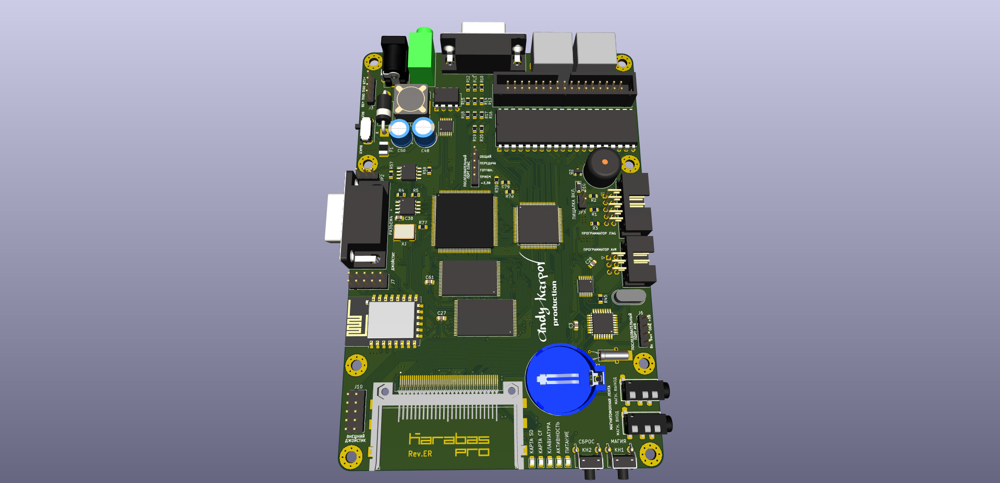
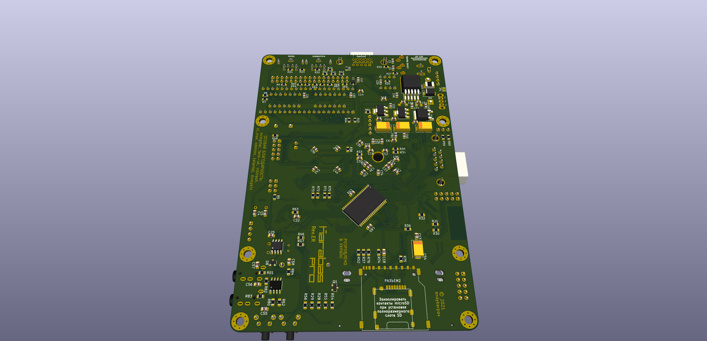

# Karabas-Pro

English | [Русский](README.ru.md) | [Українська](README.uk.md)

**Yet another FPGA ZX Spectrum clone ;)**

## Intro

Karabas-Pro is a ZX Spectrum compatible computer with a soft Z80 CPU in an Altera FPGA, floppy (FDD) and hard disk (HDD, on a Compact Flash card) controllers, PS/2 keyboard and mouse, an ESP8266 module on a UART, a real-time clock, VGA output, analog sound, joysticks and more.

## The idea

The idea was to make a small clone of the Profi (Профи) ZX Spectrum compatible computer with real FDD and HDD controllers on board. The board has the size of a real 3.5" floppy drive.

## Firmware

**The main firmware is finished and implements:**

1. ZX Spectrum classic video and the Profi hi-res mode 512×240 with a palette (16 of 256 colours)
2. Profi CMR ports for the extended peripherals
3. FDD controller, in both CP/M and classic TR-DOS modes
4. HDD controller on a Compact Flash card, Profi and NemoIDE standards (Profi CP/M and PQ-DOS)
5. PS/2 keyboard (PC XT keyboard emulation)
6. PS/2 mouse (Kempston mouse and serial MS mouse emulation)
7. VGA output, 31 kHz (the frame rate stays at 50 Hz, a 60 Hz mode is available; the monitor has to accept it)
8. Turbosound (2 × AY-3-8912), Soundrive and SAA1099 (SAA1099 only on EP4CE10, EP4CE6 has no free logic for it)
9. Atari-style joysticks in Kempston mode
10. SEGA joysticks, 3 and 6 buttons
11. Profi real-time clock, read and write
12. SD card access via Z-Controller and DivMMC
13. Turbo 7 MHz (no wait) and 14 MHz (with wait cycles)
14. ZX UNO UART at 115200 for the ESP8266 module, ZiFi API (a second ZX UNO UART on the uBus connector on EP4CE10)
15. An additional ROM bank with **PQ-DOS BIOS**
16. An additional ROM bank with **Flash Tool** by **Doctor Max**, to update the FPGA firmware and ROM banks without a programmer
17. An additional ROM bank with **FDImage Tool** by **Doctor Max**, to write TRD, SCL, PRO, TD0 and FDI images to real floppies
18. An additional ROM bank with **ZX Spectrum +3e** by **Garry Lancaster** (MMC build, SD card through Z-Controller): the core switches to the +3 memory map, Menu+F5
19. OSD menu
20. OSD full-screen overlay with settings, RTC setup and more

## Download

**Firmware:** [latest release](https://github.com/andykarpov/karabas-pro/releases/latest), the file `karabas-pro-<version>.zip`. What is inside and how to flash it: [firmware/releases](firmware/releases/README.md).

**Latest stable PCB revision:** rev.Ї (EU), [gerbers](https://github.com/andykarpov/karabas-pro/raw/master/pcb/gerbers/karabas-pro-gerbers-revEU.zip).

**PCB changelog:** [CHANGELOG-PCB.md](CHANGELOG-PCB.md).

**ERRATA:** [rev.A](ERRATA-REVA.md), [rev.B](ERRATA-REVB.md), [rev.C](ERRATA-REVC.md), [rev.DS](ERRATA-REVDS.md).

**Donations:** [DONATIONS.md](DONATIONS.md).

## Development

How to build, check and release the firmware: [docs/DEVELOPMENT.md](docs/DEVELOPMENT.md) (in Russian). In short:

- every change to `master` goes through a pull request; CI builds the FPGA cores, the CPLD and the AVR firmware for every PR;
- the Profi cores and the CPLD are built with Quartus II 13.0sp1 in a Docker image ([docker/quartus13](docker/quartus13/README.md)), the AVR firmware with [PlatformIO](https://platformio.org/);
- binaries are not stored in the repository: a release is built by CI and published on the Releases page.

Project overview: [docs/PROJECT_MEMORY.md](docs/PROJECT_MEMORY.md), plans: [docs/BACKLOG.md](docs/BACKLOG.md).

## Pictures

