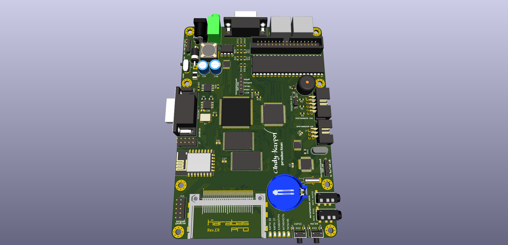
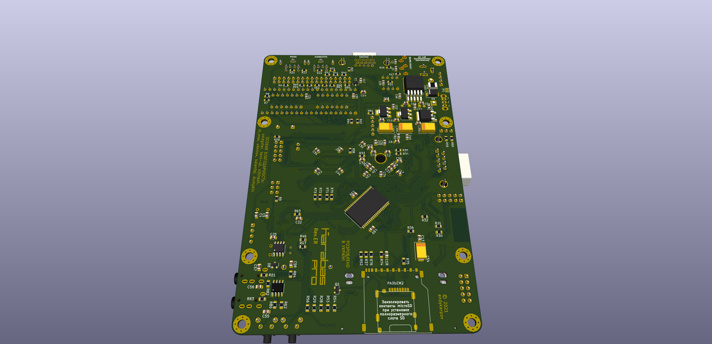

# Карабас-Про

[English](README.md) | Русский | [Українська](README.uk.md)

**Ещё один клон ZX Spectrum на ПЛИС ;)**

## Вступление

Карабас-Про — ZX Spectrum-совместимый компьютер с программным процессором Z80 в ПЛИС Altera, контроллерами НГМД (дисковод) и НЖМД (жёсткий диск на карте Compact Flash), клавиатурой и мышью PS/2, модулем ESP8266 на UART, часами реального времени, выходом VGA, аналоговым звуком, джойстиками и не только.

## Идея

Идея проекта — сделать небольшой клон ZX Spectrum-совместимого компьютера «Профи» с настоящими контроллерами дисководов и жёстких дисков на борту. Плата размером с настоящий 3,5" дисковод.

## Прошивка

**Основная прошивка закончена и реализует:**

1. Видеорежим классического ZX Spectrum и режим Профи 512×240 с палитрой (16 цветов из 256)
2. Порты Профи CMR для расширенной периферии
3. Контроллер НГМД, в режимах CP/M и классического TR-DOS
4. Контроллер НЖМД на карте Compact Flash, стандарты Профи и NemoIDE (Profi CP/M и PQ-DOS)
5. Клавиатура PS/2 (эмуляция клавиатуры PC XT)
6. Мышь PS/2 (эмуляция Kempston-мыши и последовательной MS-мыши)
7. Выход VGA, 31 кГц (частота кадров остаётся 50 Гц, есть режим 60 Гц; монитор должен её принимать)
8. Турбосаунд (2 × AY-3-8912), Soundrive и SAA1099 (SAA1099 только на EP4CE10, в EP4CE6 для него не хватает логики)
9. Джойстики Atari-типа в режиме Kempston
10. SEGA-джойстики, 3 и 6 кнопок
11. Часы реального времени Профи, чтение и запись
12. Доступ к SD-карте через Z-Controller и DivMMC
13. Турбо 7 МГц (без WAIT) и 14 МГц (с циклами WAIT)
14. UART ZX UNO на 115200 для модуля ESP8266, ZiFi API (второй UART ZX UNO на разъёме uBus на EP4CE10)
15. Дополнительный банк ПЗУ с **PQ-DOS BIOS**
16. Дополнительный банк ПЗУ с **Flash Tool** от **Doctor Max**: обновление прошивки ПЛИС и банков ПЗУ без программатора
17. Дополнительный банк ПЗУ с **FDImage Tool** от **Doctor Max**: запись образов TRD, SCL, PRO, TD0 и FDI на настоящие дискеты
18. OSD-меню
19. Полноэкранный OSD с настройками, установкой часов и не только

## Скачать

**Прошивка:** [последний релиз](https://github.com/andykarpov/karabas-pro/releases/latest), файл `karabas-pro-<версия>.zip`. Что внутри и как прошивать: [firmware/releases](firmware/releases/README.md).

**Последняя стабильная ревизия платы:** rev.Ї (EU), [гербер-файлы](https://github.com/andykarpov/karabas-pro/raw/master/pcb/gerbers/karabas-pro-gerbers-revEU.zip).

**Изменения платы:** [CHANGELOG-PCB.md](CHANGELOG-PCB.md).

**Список ошибок плат (ERRATA):** [rev.A](ERRATA-REVA.md), [rev.B](ERRATA-REVB.md), [rev.C](ERRATA-REVC.md), [rev.DS](ERRATA-REVDS.md).

**Донаты:** [DONATIONS.md](DONATIONS.md).

## Разработка

Как собирать, проверять и выпускать прошивку: [docs/DEVELOPMENT.md](docs/DEVELOPMENT.md). Коротко:

- любые изменения в `master` идут через pull request; CI собирает ядра ПЛИС, CPLD и прошивку AVR для каждого PR;
- ядра Профи и CPLD собираются в Quartus II 13.0sp1 в Docker-образе ([docker/quartus13](docker/quartus13/README.md)), прошивка AVR — в [PlatformIO](https://platformio.org/);
- бинарники в репозитории не хранятся: релиз собирает CI и публикует на странице Releases.

Обзор проекта: [docs/PROJECT_MEMORY.md](docs/PROJECT_MEMORY.md), планы: [docs/BACKLOG.md](docs/BACKLOG.md).

## Изображения платы

