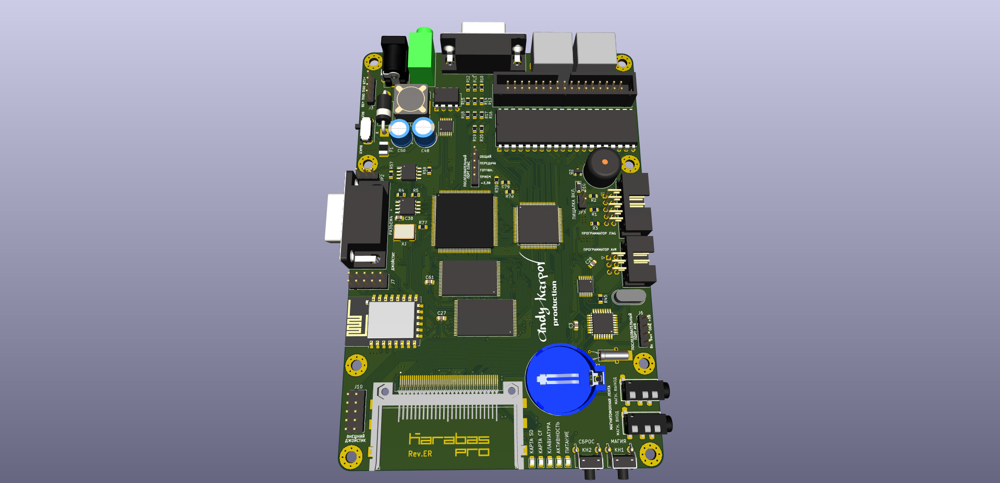
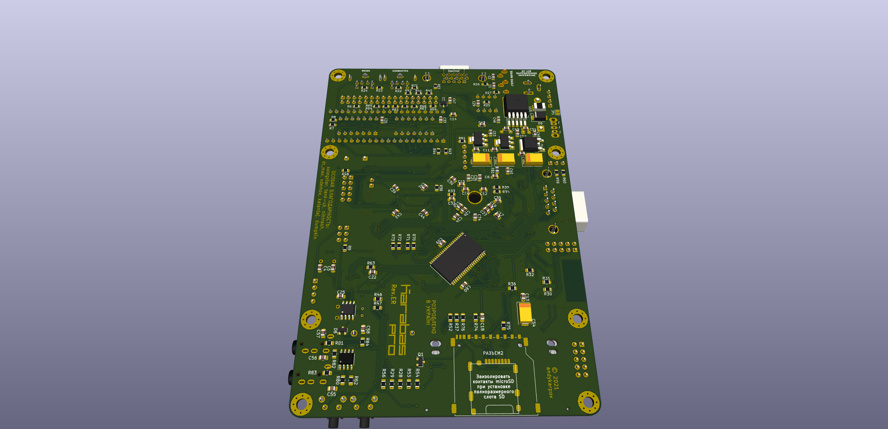

# Карабас-Про

[English](README.md) | [Русский](README.ru.md) | Українська

**Ще один клон ZX Spectrum на ПЛІС ;)**

## Інтро

Карабас-Про — ZX Spectrum-сумісний комп'ютер з програмним процесором Z80 у ПЛІС Altera, контролерами НГМД (дисковод) та НЖМД (жорсткий диск на карті Compact Flash), клавіатурою та мишею PS/2, модулем ESP8266 на UART, годинником реального часу, виходом VGA, аналоговим звуком, джойстиками тощо.

## Ідея

Ідея проєкту — зробити невеликий клон ZX Spectrum-сумісного комп'ютера «Профі» зі справжніми контролерами дисководів та жорстких дисків на борту. Плата розміром зі справжній 3,5" дисковод.

## Прошивка

**Основна прошивка закінчена та реалізує:**

1. Відеорежим класичного ZX Spectrum та режим Профі 512×240 з палітрою (16 кольорів з 256)
2. Порти Профі CMR для розширеної периферії
3. Контролер НГМД, у режимах CP/M та класичного TR-DOS
4. Контролер НЖМД на карті Compact Flash, стандарти Профі та NemoIDE (Profi CP/M та PQ-DOS)
5. Клавіатура PS/2 (емуляція клавіатури PC XT)
6. Миша PS/2 (емуляція Kempston-миші та послідовної MS-миші)
7. Вихід VGA, 31 кГц (частота кадрів лишається 50 Гц, є режим 60 Гц; монітор має її приймати)
8. Турбосаунд (2 × AY-3-8912), Soundrive та SAA1099 (SAA1099 лише на EP4CE10, у EP4CE6 для нього не вистачає логіки)
9. Джойстики Atari-типу в режимі Kempston
10. SEGA-джойстики, 3 та 6 кнопок
11. Годинник реального часу Профі, читання та запис
12. Доступ до SD-карти через Z-Controller та DivMMC
13. Турбо 7 МГц (без WAIT) та 14 МГц (з циклами WAIT)
14. UART ZX UNO на 115200 для модуля ESP8266, ZiFi API (другий UART ZX UNO на роз'ємі uBus на EP4CE10)
15. Додатковий банк ПЗУ з **PQ-DOS BIOS**
16. Додатковий банк ПЗУ з **Flash Tool** від **Doctor Max**: оновлення прошивки ПЛІС та банків ПЗУ без програматора
17. Додатковий банк ПЗУ з **FDImage Tool** від **Doctor Max**: запис образів TRD, SCL, PRO, TD0 та FDI на справжні дискети
18. OSD-меню
19. Повноекранний OSD з налаштуваннями, встановленням годинника тощо

## Завантажити

**Прошивка:** [останній реліз](https://github.com/andykarpov/karabas-pro/releases/latest), файл `karabas-pro-<версія>.zip`. Що всередині та як прошивати: [firmware/releases](firmware/releases/README.md).

**Остання стабільна ревізія плати:** rev.Ї (EU), [гербер-файли](https://github.com/andykarpov/karabas-pro/raw/master/pcb/gerbers/karabas-pro-gerbers-revEU.zip).

**Зміни плати:** [CHANGELOG-PCB.md](CHANGELOG-PCB.md).

**Перелік помилок плат (ERRATA):** [rev.A](ERRATA-REVA.md), [rev.B](ERRATA-REVB.md), [rev.C](ERRATA-REVC.md), [rev.DS](ERRATA-REVDS.md).

**Донати:** [DONATIONS.md](DONATIONS.md).

## Розробка

Як збирати, перевіряти та випускати прошивку: [docs/DEVELOPMENT.md](docs/DEVELOPMENT.md) (російською). Коротко:

- будь-які зміни в `master` йдуть через pull request; CI збирає ядра ПЛІС, CPLD та прошивку AVR для кожного PR;
- ядра Профі та CPLD збираються в Quartus II 13.0sp1 у Docker-образі ([docker/quartus13](docker/quartus13/README.md)), прошивка AVR — у [PlatformIO](https://platformio.org/);
- бінарники в репозиторії не зберігаються: реліз збирає CI та публікує на сторінці Releases.

Огляд проєкту: [docs/PROJECT_MEMORY.md](docs/PROJECT_MEMORY.md), плани: [docs/BACKLOG.md](docs/BACKLOG.md).

## Зображення плати

