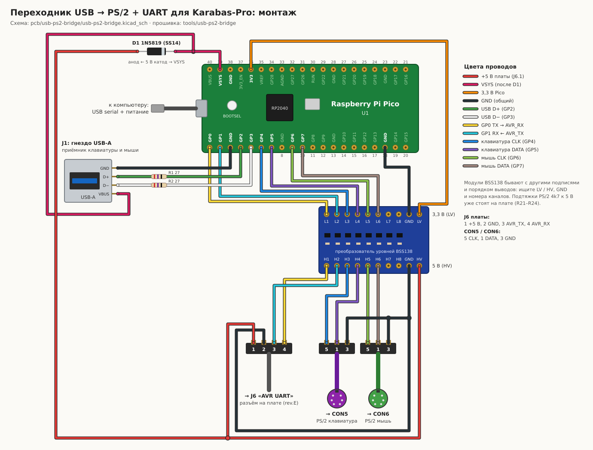

# Переходник USB → PS/2 для Karabas-Pro (RP2040)

Стенд для проверки платы без PS/2-клавиатуры: USB-клавиатура и мышь (можно одним приёмником)
превращаются в PS/2-клавиатуру и PS/2-мышь, а UART AVR (J6) выходит на USB serial компьютера в
обе стороны. Через этот порт идут команды `AT+KARABAS=` прошивки AVR (`docs/AT_KARABAS.md`):
клавиши, мышь, джойстик и пункты меню можно слать с компьютера.

Плата — Raspberry Pi Pico (или любая на RP2040 с выведенными GP0..GP7: RP2040-Zero тоже
подходит). Родной USB платы — к компьютеру (USB serial), USB-host для клавиатуры — на PIO.

## Подключение



(PNG: `doc/wiring.png`, генератор картинки: `doc/wiring.py`.)

Схема в KiCad: `pcb/usb-ps2-bridge/usb-ps2-bridge.kicad_sch` (преобразователь уровней на ней
нарисован дискретно, Q1..Q6 и R3..R14: это то же, что модуль на BSS138).

Нужен преобразователь уровней на BSS138 (модуль на 8 каналов или два по 4; с подтяжками
10 кОм с обеих сторон, как у обычных модулей). PS/2 и UART AVR — 5 В, RP2040 — 3,3 В и 5 В не
терпит. TXS0108E не брать: он плохо работает с внешними подтяжками PS/2.

| Pico (вывод) | Куда | Через |
| --- | --- | --- |
| GP2 (4) | USB-A D+ (контакт 3) | 22–27 Ом (можно напрямую) |
| GP3 (5) | USB-A D− (контакт 2) | 22–27 Ом (можно напрямую) |
| VSYS (39) | USB-A VBUS (контакт 1) | |
| GND (3, 38) | USB-A GND (контакт 4) | |
| GP4 (6) | PS/2 клавиатура CLK (CON5, контакт 5 mini-DIN) | канал 1 преобразователя |
| GP5 (7) | PS/2 клавиатура DATA (CON5, контакт 1) | канал 2 |
| GP6 (9) | PS/2 мышь CLK (CON6, контакт 5) | канал 3 |
| GP7 (10) | PS/2 мышь DATA (CON6, контакт 1) | канал 4 |
| GP1 (2), RX | J6 контакт 3 AVR_TX | канал 5 |
| GP0 (1), TX | J6 контакт 4 AVR_RX | канал 6 |
| 3V3 OUT (36) | LV преобразователя | |
| — | HV преобразователя: J6 контакт 1 (VCC 5 В) | |
| VSYS (39) | J6 контакт 1 (5 В) | диод Шоттки (1N5819, SS14): анод к 5 В, катод к VSYS |
| GND | GND преобразователя, J6 контакт 2, PS/2 контакт 3 обоих разъёмов | |

- PS/2 mini-DIN (вилка, со стороны контактов): 1 DATA, 3 GND, 4 +5 В, 5 CLK, 2 и 6 не
  заняты. Подтяжки к 5 В уже стоят на плате (R21–R24). +5 В PS/2 переходнику не нужен.
- Питание: от компьютера по USB Pico и/или от платы через диод на VSYS (тогда переходник
  работает и без компьютера). Диод нужен, чтобы 5 В платы не шли в USB компьютера; от VBUS к
  VSYS у Pico диод свой.
- USB-A VBUS от VSYS: около 4,7 В, приёмнику клавиатуры с мышью хватает.

## Прошивка

```sh
cd tools/usb-ps2-bridge && pio run   # .pio/build/pico/firmware.uf2
```

Pico в BOOTSEL (держать кнопку при подключении), скопировать `firmware.uf2` на диск `RPI-RP2`.
После этого компьютер видит USB serial «Karabas-Pro PS2 bridge»: всё, что печатает AVR, и всё,
что в него послано (115200). Светодиод Pico горит, когда подключена USB-клавиатура или мышь.

## Что внутри

`src/main.cpp`, arduino-pico + Adafruit TinyUSB + Pico-PIO-USB:

- ядро 1 — USB-host (HID boot protocol: клавиатура 8 байт, мышь кнопки + X + Y);
- ядро 0 — два PS/2-устройства ногодрыгом (12,5 кГц, отпускание линии — подтяжки
  преобразователя): коды set 2, ответы на команды AVR (`FF` → `FA AA` (у мыши ещё `00`),
  `ED` / `F3` / `E8` с аргументом, `EE`, `F2`, `F4` / `F5`, `E9`, `FE` — повтор); пакеты мыши по
  3 байта с частотой, заданной `F3`; мост UART ↔ USB serial.

Не проверено на железе (на 2026-11-20): собирается, логика PS/2 — по спецификации и по драйверам
AVR (`firmware/src/avr/src/ps2_kbd.c`, `mouse.c`).
